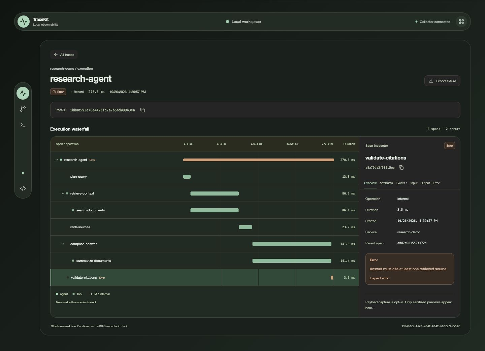
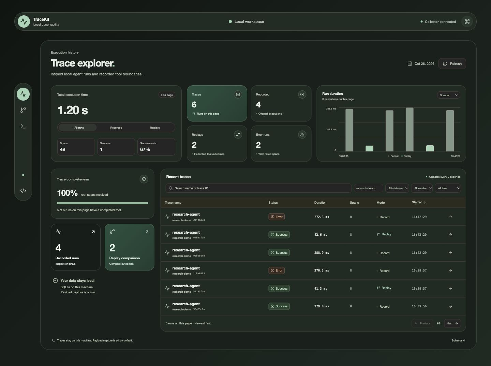
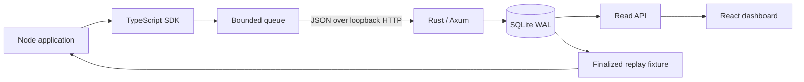

# TraceKit

**Local-first observability and controlled-boundary replay for TypeScript agents.**

Trace nested async workflows, inspect their execution in a browser, and replay recorded tool results without invoking the live handlers. Rust + SQLite on your machine. No API keys, external account, or hosted telemetry service.

[](https://github.com/mvritz/tracekit/actions/workflows/ci.yml)
[](LICENSE)



> Initial implementation, version 0.1.0. Packages are **not published to npm**. Build from this repository. The screenshot is a real execution of the synthetic offline demo, not a mockup.

## Quickstart

Prerequisites: **Node 22.12+** (tested with 24.0.1), **Bun 1.3.13**, and **Rust 1.92.0**. The Rust toolchain is pinned in `rust-toolchain.toml`. Install the pinned Bun version from [bun.sh](https://bun.sh). Bun is required for workspace installation and commands; the install guard rejects other package managers and versions. The SDK remains compatible with Node.

```bash
git clone https://github.com/mvritz/tracekit.git
cd tracekit
bun install --frozen-lockfile
bun run dev
```

Leave that terminal running. In another terminal, from the repository root:

```bash
bun run demo:record
bun run demo:failure
bun run demo:replay
```

Open **http://127.0.0.1:3000**. The collector listens at **http://127.0.0.1:4319** and creates `.tracekit/tracekit.db`. The demo retrieves three fixed documents, uses a local model stub, and validates citations. The failure run deliberately omits citations; the waterfall identifies `validate-citations` as the failing step. The replay command disables the live tools and reports `liveCalls: 0`.

Replay the recorded failure with the same workflow:

```bash
bun run demo:replay .tracekit/failure-fixture.json
```

Use `127.0.0.1` for the dashboard URL: the default origin allowlist intentionally does not also allow `localhost`. The first Rust compilation downloads and builds dependencies; subsequent starts are faster. Ctrl-C shuts down both development processes.

## Instrument a workflow

The SDK is a Node ESM package. Inside the workspace, import `@tracekit/sdk` after `bun run build`. See [packaging](CONTRIBUTING.md#package-checks) for use in another local project.

```ts
import { createTraceKit } from '@tracekit/sdk';

const tk = createTraceKit({ serviceName: 'my-agent' });

const answer = await tk.trace('answer-question', async () => {
  const result = await tk.recordTool(
    'lookup',
    async (input: { query: string }) => ({ answer: input.query.toUpperCase() }),
    { query: 'cache invalidation' },
  );
  return tk.span('validate', () => result.answer.length > 0);
});

await tk.shutdown();
```

`trace`, `span`, and `recordTool` always return promises. They preserve callback return values and original exceptions. `AsyncLocalStorage` keeps nested and concurrent sibling spans attached to the correct parent. Nested `trace` calls create independent runs; a `span` outside a trace creates an implicit root. Instrumentation failures are reflected in diagnostics, without replacing the application's result.

Inputs, outputs, and error messages are **off by default**. Names and explicitly supplied attributes are still metadata: don't put sensitive values in them. Enable capture deliberately, with additional redaction for your data:

```ts
const tk = createTraceKit({
  serviceName: 'my-agent',
  capture: { inputs: true, outputs: true, errors: true },
  redaction: { keys: ['email'], patterns: [/customer-\d+/g] },
  replay: { mode: 'record', capture: true }, // independent opt-in
});
```

## Replay without live tool calls

A replay reruns your local control flow and substitutes saved JSON results or typed errors at `recordTool` boundaries. It never falls back to the live handler.

```ts
import { createTraceKit, loadReplayFixture } from '@tracekit/sdk';

const fixture = await loadReplayFixture('.tracekit/demo-fixture.json');
const tk = createTraceKit({
  serviceName: 'research-demo',
  replay: { mode: 'replay', fixture },
});
// Call the same application entry point with tk, then await tk.shutdown().
```

Matching uses the boundary name, initiation sequence, and SHA-256 of canonical, sanitized input. Wrong inputs, unknown or extra calls, and unused fixture entries raise `ReplayMismatchError`. Recorded exceptions become `RecordedToolError`. Replay runs have distinct IDs and link to their source run.

Only finalized, complete, explicitly opted-in fixtures can be exported. Replay data has its own SQLite tables and schema; truncated display previews are never replay records. Export through the dashboard or `GET /v1/runs/{run_id}/replay-fixture`. Load a fixture into your own Node application; the collector never executes application code.

**Limits:** v0.1 supports sequential tool boundaries. Overlapping or nested tools cannot produce a finalized recording. Tool values must be bounded, acyclic, plain JSON. Replays return sanitized values, which can differ from the original private values. Uninstrumented filesystem/network calls, clocks, randomness, worker threads, process globals, source changes, and scheduling remain outside the replay guarantee. See [replay semantics](docs/replay.md).

## Dashboard

A dark workspace with a subtle charcoal-to-forest gradient, opaque mint/charcoal cards, and distinct trace, replay, and terminal navigation icons. The overview shows execution totals, run counts, a duration/span chart, and root-span completeness using the six runs on the current page. All filters, chart bars, and mode controls operate on real collector data. [Design notes](docs/visual-design.md).

- Trace list with name/ID search, exact service filter, status, mode, time windows, and cursor pagination.
- Windowed waterfall for up to 10,000 spans, monotonic durations, keyboard span selection across unmounted rows, ID copying, and error indicators that remain visible when parents are folded.
- Inspector for overview, attributes, events, captured input/output, and error details. No return value, captured `null`, literal marker strings, and “Not captured” are distinct. Older ambiguous captures retain their raw preview and an explanation.
- Linked original/replay comparison by hierarchical name and occurrence. Timing comparisons explicitly account for substituted IO.
- Last retrieved data remains visible during collector outages. Two-second lightweight health/summary polling recovers automatically; completed traces only download spans again when their count changes.



## Architecture



| Directory                 | Responsibility                                                  |
| ------------------------- | --------------------------------------------------------------- |
| `packages/protocol`       | Zod contracts, types, canonicalization, shared TS/Rust fixtures |
| `packages/sdk`            | Async context, sanitization, HTTP queue, strict replay          |
| `crates/collector`        | Axum API, validation, migrations, atomic SQLite storage         |
| `apps/dashboard`          | React, TanStack Query, CSS, timeline and inspector              |
| `examples/research-agent` | Fully offline success, failure, and replay workflow             |
| `tests/e2e`               | Real SDK → collector → database → browser checks                |

## Reliability and local security

The SDK queue is bounded by count and 8 MiB, with a drop-newest policy. Batches retry network errors, 429, and 5xx with bounded backoff. Permanent rejections are dropped and counted. Each drain has a five-second deadline; `shutdown` stops the timer and drops any remaining queue. Delivery is best effort, not durable. Check `tk.getDiagnostics()`.

Ingestion is atomic and immutable. Identical duplicate spans deduplicate; conflicting spans or run identities return 409 and roll back the entire batch. Child-first delivery and unknown parents are allowed. Self-parenting, cycles, multiple roots, and inconsistent run identities are rejected. Any failed span makes the trace summary an error, even if its parent catches the exception.

The dashboard warns when the logical database size exceeds 250 MiB; retention is manual. The collector binds only to loopback, validates browser Origin and Host headers, limits bodies to 1 MiB, and rejects non-JSON writes. It has no remote authentication or arbitrary-code execution endpoint. Treat other local processes as trusted. Redaction is best effort; it cannot identify every secret or PII. SQLite, fixtures, and backups still need your normal disk protection. [Privacy model](docs/privacy.md) · [Threat model](SECURITY.md)

## Configuration

| Collector variable        | Default                                            |
| ------------------------- | -------------------------------------------------- |
| `TRACEKIT_SERVER_HOST`    | `127.0.0.1` (loopback required)                    |
| `TRACEKIT_SERVER_PORT`    | `4319`                                             |
| `TRACEKIT_DB_PATH`        | `.tracekit/tracekit.db`                            |
| `TRACEKIT_ALLOWED_ORIGIN` | `http://127.0.0.1:3000` (one loopback HTTP origin) |
| `TRACEKIT_LOG_LEVEL`      | `info`                                             |

SDK capture and batching are configured through the typed API, **not environment variables**. Ingestion caps are fixed in v0.1. The dashboard uses the default collector address; changing its port requires changing `apps/dashboard/src/lib/api.ts`. [API and limits](docs/protocol.md) · [SDK reference](docs/sdk.md)

## Verify and measure

```bash
bun run check                 # build, format, lint, types, unit/component/contract tests
cargo fmt --all --check
cargo clippy --workspace --all-targets --locked -- -D warnings
cargo test --workspace --locked
bunx --no-install playwright install chromium
bun run test:e2e             # starts local services if needed
bun run smoke                # requires collector; records, exports, replays, verifies
bun run bench                # requires collector; writes raw benchmark results
bun run bench:dashboard      # requires collector + dashboard + Chromium
```

Tests cover async context, unchanged callback behavior, pre-network redaction, zero live replay calls, mismatches, queue outages, atomic idempotency, concurrent writes, cross-language contracts, XSS text rendering, keyboard navigation, and desktop/mobile layout. CI runs the native stack on Linux, with JavaScript checks on Linux and macOS.

Benchmark results and methodology live in [docs/benchmarks.md](docs/benchmarks.md). They are measurements on one machine, not production guarantees. Database retention is manual: stop the collector, back up `.tracekit/`, then run `bun run clean:data --yes` to delete this checkout's trace data and demo fixtures. Never commit `.tracekit/`.

## Status and roadmap

Implemented: the tracing SDK, HTTP transport, atomic local ingestion, migrations, trace search and waterfall, explicit redaction, sequential strict replay, fixture import/export, linked comparison, offline examples, tests, and repeatable benchmarks.

Remaining work includes retention policies, additional platforms and browsers, streaming updates, stable-key concurrent replay, and an optional OpenTelemetry bridge. IDs follow W3C widths; full OpenTelemetry interoperability and automatic distributed propagation are not implemented. This is a developer tool, not a hosted/multi-user service or full arbitrary-program recorder.

[Contributing](CONTRIBUTING.md) · [Security reporting](SECURITY.md) · [Architecture decisions](docs/adr) · [Troubleshooting](docs/troubleshooting.md) · [Initial release notes](CHANGELOG.md)

The original planning document is preserved as [historical specification](docs/product-specification.md). Current contracts and limitations are documented here and in `docs/`; its example task prompts are not runtime instructions.

## License

[MIT](LICENSE) © 2026 mvritz.
