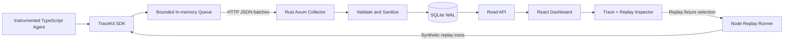

# TraceKit

> **Local-first observability and deterministic replay for TypeScript AI agents.**
>
> Instrument async workflows with a few lines of TypeScript, inspect nested executions in a browser, and replay recorded tool boundaries without repeating live side effects.

[](LICENSE)


> [!IMPORTANT]
> **Project status: specification, not implemented software.** The examples below are target developer experiences and contracts for building v0.1; they are not claims that packages, commands, features, performance, or benchmarks already exist. Replace this note as each feature ships.

## Contents

1. [Vision and product boundaries](#1-vision-and-product-boundaries)
2. [User journeys and definition of done](#2-user-journeys-and-definition-of-done)
3. [Proposed repository and toolchain](#3-proposed-repository-and-toolchain)
4. [System architecture](#4-system-architecture)
5. [Canonical trace data model](#5-canonical-trace-data-model)
6. [TypeScript SDK contract](#6-typescript-sdk-contract)
7. [Rust collector and HTTP API](#7-rust-collector-and-http-api)
8. [SQLite storage specification](#8-sqlite-storage-specification)
9. [Deterministic replay specification](#9-deterministic-replay-specification)
10. [Dashboard UX and accessibility](#10-dashboard-ux-and-accessibility)
11. [Configuration, security, and privacy](#11-configuration-security-and-privacy)
12. [Reliability and performance](#12-reliability-and-performance)
13. [Testing strategy](#13-testing-strategy)
14. [Milestone-by-milestone implementation plan](#14-milestone-by-milestone-implementation-plan)
15. [Codex operating instructions and task prompts](#15-codex-operating-instructions-and-task-prompts)
16. [Developer commands and CI](#16-developer-commands-and-ci)
17. [Documentation and open-source launch](#17-documentation-and-open-source-launch)
18. [Definition of v0.1 and non-goals](#18-definition-of-v01-and-non-goals)
19. [Technical decisions and open questions](#19-technical-decisions-and-open-questions)

---

## 1. Vision and product boundaries

### 1.1 The problem

Agentic applications behave like distributed programs: an incoming user request may trigger multiple LLM calls, tools, retries, retrieval operations, and validations. A normal log stream does not tell a developer which nested operation was slow, what inputs produced a failure, whether an error was caused by a model or a tool, or how to reproduce the failure safely.

Existing observability products often target cloud services, hosted analytics, or general-purpose traces. **TraceKit's initial differentiation is a fast, local, inspectable developer loop with explicit replay semantics**—not another all-in-one hosted LLM analytics platform.

### 1.2 Who is it for?

- TypeScript developers building agents, retrieval systems, and multi-step AI workflows.
- Teams that want to inspect local execution without sending traces to a hosted service.
- Engineers debugging nondeterministic tool chains and flaky integrations.
- Open-source contributors interested in async context propagation, Rust services, structured telemetry, storage, and developer tooling.

### 1.3 Core product promise

A developer should be able to:

1. Start the local collector and dashboard.
2. Wrap an async TypeScript workflow using the SDK.
3. Run the workflow and see a trace appear within seconds.
4. Expand nested spans and inspect durations, attributes, failures, and redacted payload previews.
5. Re-run the same application workflow with recorded **tool responses substituted at explicitly registered boundaries**; compare the original and replay traces.

### 1.4 Principles

- **Local-first:** runs on a developer laptop, with SQLite and no required external account.
- **Low friction:** a small SDK, explicit APIs, minimal configuration.
- **No magic determinism:** replay is deterministic only for controlled, recorded boundaries with stable matching rules.
- **Safe by default:** inputs and outputs are **not stored by default**; sensitive fields can be redacted before serialization, disk, or network transfer.
- **Performance-aware:** SDK recording must not block application workflows on collector availability.
- **Open standards:** use W3C trace context and OpenTelemetry-compatible identifiers/conventions where feasible; clearly document deviations.
- **Honest product language:** never describe a replay of recorded tool outputs as a real rerun of remote services.

### 1.5 MVP feature tiers

| Priority | Feature                          | MVP behavior                                                     |
| -------- | -------------------------------- | ---------------------------------------------------------------- |
| P0       | Nested span tracing              | AsyncLocalStorage context, parent-child relationships            |
| P0       | TypeScript SDK                   | `trace`, `span`, `recordTool`, `flush`, `shutdown`               |
| P0       | Local Rust ingestion server      | Validates and stores batches in SQLite                           |
| P0       | Dashboard                        | Trace list, waterfall, details, errors, filtering                |
| P0       | Redaction                        | Opt-in payload capture plus configurable sanitizer               |
| P0       | Record-and-replay                | Recorded tool boundaries, strict matching, no external execution |
| P0       | Sample application               | A deterministic demo with a failing and repaired workflow        |
| P1       | Search and comparison            | Filter by agent, status, time; compare original and replay       |
| P1       | Export/import                    | Portable, versioned replay fixtures with explicit sanitization   |
| P1       | OpenTelemetry bridge             | Optional interoperable ingestion/export                          |
| P2       | Live streaming                   | WebSockets or SSE instead of polling                             |
| P2       | Hosted and multi-user            | Not in initial release                                           |
| P2       | Automatic framework integrations | Not in initial release                                           |

---

## 2. User journeys and definition of done

### Journey A: inspect a slow agent

1. Install `@tracekit/sdk` in the example agent project.
2. Start TraceKit locally.
3. Run an agent with a retrieval step, model step, and validation step.
4. Open `http://127.0.0.1:3000`.
5. See a trace summary and a nested timeline showing the slow step.
6. Click the slow span to see name, duration, status, attributes, safe payload preview (if enabled), and events.

**Acceptance criteria:** a trace with four nested spans preserves parent IDs, correct time ordering, exception status, and measured duration; UI responds when the collector is restarted; missing input capture is clearly labeled rather than shown as empty input.

### Journey B: reproduce an external tool failure safely

1. Register `recordTool('lookupAccount', handler)` around a fake external service.
2. During a recording run, the service returns a recorded response or a deliberately thrown exception.
3. Stop the external service.
4. Start a replay with the captured fixture and the **same workflow code**.
5. The replay engine supplies the saved return value/error at the registered boundary and never invokes the live handler.
6. Compare original vs replay step outcomes and identify divergence.

**Acceptance criteria:** mock server call counter stays at zero during replay; strict matching detects missing, extra, or mismatched tool calls; a recorded exception can be reenacted as a typed replay error; the resulting trace is marked `replay` and points back to the recorded run.

### Journey C: keep secrets out of traces

1. Execute a request containing a bearer token and personal email.
2. Enable payload capture but configure redaction rules.
3. Inspect raw ingestion requests, the SQLite file, replay export, and UI.

**Acceptance criteria:** configured secrets are absent from all persisted/exported payloads and logs; default capture without opt-in stores only safe metadata; an unsafe replay fixture is rejected or requires explicit acknowledgement before import.

---

## 3. Proposed repository and toolchain

Use a **pnpm monorepo** for JavaScript packages and a Rust workspace under `crates/`. Pin actual supported tool versions in configuration/lockfiles when implementation begins, not speculative version numbers in this README.

```text
tracekit/
├── README.md
├── LICENSE                         # MIT
├── CONTRIBUTING.md
├── CODE_OF_CONDUCT.md
├── SECURITY.md
├── AGENTS.md                        # Codex instructions
├── .editorconfig
├── .gitignore
├── .github/
│   └── workflows/
│       ├── ci.yml
│       └── release.yml
├── pnpm-workspace.yaml
├── package.json
├── pnpm-lock.yaml
├── tsconfig.base.json
├── Cargo.toml                       # Rust workspace
├── Cargo.lock
├── packages/
│   ├── sdk/
│   │   ├── src/
│   │   │   ├── index.ts
│   │   │   ├── client.ts
│   │   │   ├── context.ts
│   │   │   ├── span.ts
│   │   │   ├── transport.ts
│   │   │   ├── sanitizer.ts
│   │   │   ├── replay.ts
│   │   │   └── types.ts
│   │   ├── test/
│   │   └── package.json
│   ├── protocol/
│   │   ├── src/
│   │   │   ├── schemas.ts
│   │   │   ├── types.ts
│   │   │   └── fixtures/
│   │   └── package.json
│   └── config/
│       └── eslint/                 # Optional shared lint config
├── crates/
│   ├── collector/
│   │   ├── src/
│   │   │   ├── main.rs
│   │   │   ├── server.rs
│   │   │   ├── config.rs
│   │   │   ├── routes/
│   │   │   │   ├── ingest.rs
│   │   │   │   ├── traces.rs
│   │   │   │   └── replay.rs
│   │   │   ├── models.rs
│   │   │   ├── storage.rs
│   │   │   └── errors.rs
│   │   ├── migrations/
│   │   └── tests/
│   └── protocol/                    # Optional Rust protocol types
├── apps/
│   └── dashboard/
│       ├── src/
│       │   ├── app/
│       │   ├── components/
│       │   │   ├── TraceTable.tsx
│       │   │   ├── SpanWaterfall.tsx
│       │   │   ├── SpanInspector.tsx
│       │   │   └── ReplayComparison.tsx
│       │   ├── hooks/
│       │   ├── lib/
│       │   └── styles/
│       └── package.json
├── examples/
│   └── research-agent/
│       ├── src/
│       ├── package.json
│       └── README.md
├── docs/
│   ├── architecture.md
│   ├── protocol.md
│   ├── replay.md
│   ├── privacy.md
│   ├── troubleshooting.md
│   └── adr/
│       ├── 0001-local-first.md
│       └── 0002-replay-boundaries.md
└── scripts/
    ├── dev.sh
    └── smoke-test.sh
```

### 3.1 Stack decisions

| Area                | Default choice                         | Notes                                                                  |
| ------------------- | -------------------------------------- | ---------------------------------------------------------------------- |
| SDK                 | TypeScript, Node.js, ESM-first         | Node `AsyncLocalStorage`; browser support deferred                     |
| Type validation     | Zod in TS                              | Export JSON Schema or golden fixtures as source for Rust compatibility |
| Rust HTTP           | Axum + Tokio                           | Explicit error handling; structured tracing                            |
| Database            | SQLite + sqlx                          | Use migrations, transactions, WAL, bounded pool                        |
| Dashboard           | React + Vite + TypeScript              | Small footprint; start without SSR                                     |
| Data fetching       | TanStack Query                         | Poll first; add SSE only if justified                                  |
| Styling             | Tailwind CSS or CSS modules            | Choose one and document it                                             |
| Unit/integration    | Vitest, Rust `cargo test`, Playwright  | Real end-to-end tests                                                  |
| Package manager     | pnpm                                   | Workspace tooling and lockfile                                         |
| Local orchestration | pnpm scripts + optional Docker Compose | Native running should be possible                                      |

### 3.2 Version policy

At implementation time, pick currently maintained releases verified against official documentation, record exact major versions in `package.json`/`Cargo.toml`, commit both lockfiles, and set minimum supported Node/Rust versions in CI. Avoid floating `latest` in reproducible build steps.

---

## 4. System architecture



### 4.1 Process boundaries

- **Application process:** user's TypeScript application and the SDK. Instrumentation is opt-in. The SDK accumulates spans in a bounded queue and attempts best-effort batch delivery.
- **Collector process:** listens on loopback by default. Validates payload size/schema/parent relationships where possible, writes events transactionally, and serves read APIs. It **must not execute arbitrary user code**.
- **Dashboard process:** browser application querying the collector. Can be a separate dev server initially. The UI never directly reads the SQLite file.
- **Replay runner:** a dedicated local Node process/API chosen by the user to run **their own entry point with an explicit replay context**. It must not be executed by the collector in v0.1. The dashboard can export a run command rather than remotely launching arbitrary code.

### 4.2 Request and write paths

1. `trace()` creates a root span and establishes async context.
2. Child `span()` or `recordTool()` calls create children sharing `traceId` and their `parentSpanId`.
3. On completion/error, immutable span envelopes enter a bounded queue.
4. Transport sends batches to `POST /v1/ingest/spans` with bounded timeout and retries.
5. Collector validates request and inserts spans in one transaction with idempotent IDs.
6. Dashboard polls `/v1/traces` and `/v1/traces/:id/spans`.

### 4.3 Clock policy

- Store UTC `start_time_unix_ms` and `end_time_unix_ms` (epoch milliseconds) for cross-process display, plus monotonic `duration_ns` measured by `performance.now()`/`process.hrtime.bigint()` in the SDK.
- Do not derive accurate cross-machine ordering from wall clock timestamps alone; v0.1 documents the single-machine assumption.
- For a span that ends before its recorded start due to an invalid clock input, reject it.
- UI waterfall offsets use start timestamps relative to trace start; durations come from monotonic measurements. Clamp display widths only visually, never mutate stored values.

### 4.4 Failure model

- Collector unavailable: SDK completes application execution normally; increments dropped/failed-delivery counters, and logs only bounded diagnostic summaries if enabled.
- Malformed telemetry: collector responds with structured validation error; never crashes.
- Database locked/full: collector returns 503 or a specific error; backpressure is reported, not silently claimed successful.
- Browser offline: UI displays last retrieved data and an explicit connection banner.
- Replay mismatch: replay run stops with structured `ReplayMismatchError`; no fallback to live tool execution unless a future explicitly unsafe mode is separately designed (out of v0.1).

---

## 5. Canonical trace data model

### 5.1 Identifiers

Use W3C-compatible lowercase hexadecimal strings:

- `trace_id`: 32 hex characters (128 bits), nonzero.
- `span_id`: 16 hex characters (64 bits), nonzero.
- `parent_span_id`: nullable 16 hex characters.
- Generate IDs with cryptographically secure randomness, not timestamps or `Math.random()`.
- IDs are unique across SDK runs; ingestion of the same span ID for the same trace is idempotent when canonical content matches.

### 5.2 Span envelope (`schema_version = 1`)

```json
{
  "schema_version": 1,
  "trace_id": "9b8cc6ee168d4e308f7e9af42fd6142b",
  "span_id": "67078f6a39a15c29",
  "parent_span_id": null,
  "run_id": "018f0f00-0000-7000-8000-000000000001",
  "name": "research-agent",
  "kind": "agent",
  "status": "ok",
  "start_time_unix_ms": 1780000000000,
  "end_time_unix_ms": 1780000001284,
  "duration_ns": 1284000000,
  "service_name": "research-demo",
  "attributes": {
    "tracekit.mode": "record",
    "workflow.version": "demo-v1"
  },
  "events": [],
  "payload": null,
  "error": null
}
```

> Example identifiers, timestamp, and metrics are illustrative—not measured values.

### 5.3 Field definitions

| Field                | Type        | Rules                                                      |
| -------------------- | ----------- | ---------------------------------------------------------- |
| `schema_version`     | integer     | Exactly `1` in v0.1                                        |
| `trace_id`           | string      | 32 hex chars, not all zero                                 |
| `span_id`            | string      | 16 hex chars, not all zero                                 |
| `parent_span_id`     | string/null | Must not equal `span_id`                                   |
| `run_id`             | UUID string | Each original or replay execution has its own run ID       |
| `name`               | string      | 1–200 printable chars                                      |
| `kind`               | enum        | `agent`, `llm`, `tool`, `retrieval`, `internal`            |
| `status`             | enum        | `ok`, `error`, `cancelled`                                 |
| `start_time_unix_ms` | integer     | Epoch ms, nonnegative                                      |
| `end_time_unix_ms`   | integer     | Epoch ms >= start                                          |
| `duration_ns`        | integer     | Nonnegative, <= documented safety bound                    |
| `service_name`       | string      | 1–100 chars                                                |
| `attributes`         | map         | JSON primitives; size/depth limited; no secrets by default |
| `events`             | array       | Capped list of `{name, time_unix_ms, attributes}`          |
| `payload`            | object/null | Null unless capture enabled; typed redacted previews       |
| `error`              | object/null | `{type, message, stack?}` with sanitized/capped fields     |

### 5.4 Payload schema

```ts
type PayloadPreview = {
  input?: unknown;
  output?: unknown;
  input_truncated?: boolean;
  output_truncated?: boolean;
  redacted_paths?: string[];
};
```

Never assume a general JSON serializer is safe for arbitrary values. Handle cyclic objects, `Error`, `BigInt`, buffers, symbols, functions, `undefined`, Dates, and deeply nested objects predictably. Store only JSON-compatible, sanitized previews. Maximum payload size is configurable with a conservative default (e.g., 32 KiB per span after sanitization).

### 5.5 Trace summary computed server-side

A trace summary includes `trace_id`, `run_id`, root span name, start/end, duration, span count, error count, service, mode (`record`/`replay`), and optionally `replay_of_run_id`. Define status as `error` if any relevant span fails (unless the failure is explicitly handled and policy is documented). Never imply all spans succeeded because the root returned normally.

### 5.6 Batching contract

```json
{
  "schema_version": 1,
  "source": { "sdk": "tracekit-node", "version": "0.1.0" },
  "spans": [/* one or more SpanEnvelope objects */]
}
```

Limits at ingestion: no more than 100 spans per batch, max request body 1 MiB, max attributes/event/payload depth, 400 for malformed request, 413 for oversized body. Make these defaults configurable only with explicit server caps.

### 5.7 Golden fixtures

Maintain valid/invalid JSON fixtures in `packages/protocol/src/fixtures/`, tested by both TypeScript and Rust. Cases include: invalid IDs, zero IDs, oversized strings, child with unknown parent, repeated span ID with identical vs conflicting content, and unexpected version. Cross-language tests should compare parsing and canonical serialization behavior.

---

## 6. TypeScript SDK contract

### 6.1 Target public API

```ts
import { createTraceKit, type TraceKitClient } from '@tracekit/sdk';

const tk: TraceKitClient = createTraceKit({
  endpoint: 'http://127.0.0.1:4319',
  serviceName: 'research-demo',
  capture: { inputs: false, outputs: false, errors: true },
  batching: { maxBatchSize: 50, flushIntervalMs: 500, maxQueueSize: 2000 },
});

const answer = await tk.trace('research-agent', async () => {
  const docs = await tk.recordTool(
    'search-documents',
    async (args: { query: string }) => {
      return searchDocuments(args.query);
    },
    { query: 'How does caching work?' },
  );

  return tk.span('compose-answer', async () => summarize(docs), {
    kind: 'llm',
    attributes: { 'model.provider': 'example-provider' },
  });
});

await tk.flush();
await tk.shutdown();
```

The example uses a proposed overload of `recordTool(name, handler, input)`. Implement this signature consistently; do not mix with `recordTool(name, input, handler)` in examples or code.

### 6.2 Interfaces

```ts
type SpanKind = 'agent' | 'llm' | 'tool' | 'retrieval' | 'internal';
type RunMode = 'record' | 'replay';

type TraceOptions = {
  attributes?: Record<string, string | number | boolean | null>;
  captureInput?: boolean;
  captureOutput?: boolean;
};

type SpanOptions = TraceOptions & { kind?: SpanKind };

type TraceKitOptions = {
  endpoint?: string;
  serviceName: string;
  capture?: { inputs?: boolean; outputs?: boolean; errors?: boolean };
  redaction?: {
    keys?: string[];
    patterns?: RegExp[];
    custom?: (value: unknown) => unknown;
  };
  batching?: {
    maxBatchSize?: number;
    flushIntervalMs?: number;
    maxQueueSize?: number;
    requestTimeoutMs?: number;
    maxRetries?: number;
  };
  replay?: {
    mode: 'record' | 'replay';
    fixture?: ReplayFixture;
  };
};

interface TraceKitClient {
  trace<T>(name: string, callback: () => Promise<T> | T, options?: TraceOptions): Promise<T>;
  span<T>(name: string, callback: () => Promise<T> | T, options?: SpanOptions): Promise<T>;
  recordTool<I, O>(
    name: string,
    handler: (input: I) => Promise<O> | O,
    input: I,
    options?: TraceOptions,
  ): Promise<O>;
  flush(): Promise<void>;
  shutdown(): Promise<void>;
  getDiagnostics(): { queued: number; dropped: number; delivered: number; failures: number };
}
```

Note: `trace` always returns `Promise<T>` for API consistency even for synchronous callbacks. TraceKit **must propagate the callback's original return value and original exception**, never replace application behavior with instrumentation errors.

### 6.3 Async context propagation

Use Node `AsyncLocalStorage<{traceId, spanId, runId, mode}>`.

- Root `trace()` creates a new context.
- Nested `span()` creates a child context and restores parent context when the callback resolves/rejects.
- `Promise.all` siblings must get distinct span IDs and the same correct parent.
- Nested `trace()` defaults to a new root run unless an explicit parent-continuation API is added and documented.
- Outside of an active trace, `span()` can create an implicit root trace, but label this behavior clearly and test it.
- Document limits: worker threads and process boundaries require explicit context propagation; do not promise automatic distributed propagation.

### 6.4 Span lifecycle

1. Generate IDs and mark start wall/monotonic times.
2. Enter child async context.
3. Invoke callback exactly once.
4. On resolved callback: record `ok`, optionally record sanitized output.
5. On rejection/throw: record `error`, capture sanitized error metadata, rethrow exactly the original error.
6. In `finally`: calculate monotonic duration and enqueue exactly one completed span.

Test sync throws, async rejection, cancellation with `AbortSignal` when supported, and multiple concurrent child spans.

### 6.5 Transport algorithm

- Push serialized completed spans onto bounded FIFO queue.
- Flush when reaching batch size, on interval, or explicit flush/shutdown.
- Only one flush worker drains a queue at a time (or otherwise ensure no duplicate delivery).
- Preserve a batch across retry until acknowledged; use deterministic IDs for idempotency.
- Retry transient network failures, `429`, and `5xx` with capped exponential backoff + jitter; never retry `400` validation indefinitely.
- Bound number of attempts and queue memory; evict with a documented policy and increment `dropped`.
- Do not log payloads when transport fails.
- `flush()` has a finite timeout and a documented result/exception policy. `shutdown()` stops interval timers and attempts a bounded final drain.
- SDK must not keep short-lived Node processes alive unexpectedly: timers can use `unref()` where available.

### 6.6 Redaction pipeline

**Before enqueue and before any network request:**

`raw object -> safe serialization -> key/path redaction -> pattern redaction -> size limits -> immutable payload preview -> queue`

Default denied fields include, case-insensitively, `authorization`, `cookie`, `set-cookie`, `token`, `api_key`, `apikey`, `secret`, `password`, `private_key`, and `access_key`. Key matching must handle nested objects/arrays and reasonable variants; optionally redact emails/PII when requested. Explicitly state that heuristic scrubbing cannot guarantee removal of every sensitive value. Do **not** store raw original values in error strings, logs, or fixtures.

### 6.7 SDK packaging

- ESM-first, typed exports, Node-specific subpath if necessary.
- Define `exports`, `types`, `files`, `engines`, and package metadata.
- Publish only built files; tests and fixtures are not required in the npm tarball.
- `npm pack --dry-run` is a release gate.
- Do not claim browser compatibility until transport and context behavior are implemented for browsers.

---

## 7. Rust collector and HTTP API

### 7.1 Defaults

- Address: `127.0.0.1:4319` (loopback only).
- SQLite file: `./.tracekit/tracekit.db` or configurable absolute path.
- JSON UTF-8 requests, response `Content-Type: application/json`.
- Schema validation before storage; typed error responses.
- Graceful SIGINT/SIGTERM shutdown.

### 7.2 API endpoints

| Method | Endpoint                           | Purpose                                              |
| ------ | ---------------------------------- | ---------------------------------------------------- |
| `GET`  | `/healthz`                         | Process alive + optional DB readiness                |
| `GET`  | `/v1/meta`                         | Server version and supported schema versions         |
| `POST` | `/v1/ingest/spans`                 | Ingest idempotent span batch                         |
| `GET`  | `/v1/traces`                       | Paginated summaries and filters                      |
| `GET`  | `/v1/traces/{trace_id}`            | Trace metadata and summary                           |
| `GET`  | `/v1/traces/{trace_id}/spans`      | All spans for a trace (capped)                       |
| `GET`  | `/v1/runs/{run_id}`                | Run metadata                                         |
| `GET`  | `/v1/runs/{run_id}/replay-fixture` | Export sanitized fixture; explicit local-only action |

Avoid an endpoint that executes user-supplied code. Replay executes in the user's local Node application with SDK replay mode, not inside Rust.

### 7.3 Ingestion response

```http
POST /v1/ingest/spans
Content-Type: application/json
```

```json
{
  "schema_version": 1,
  "source": { "sdk": "tracekit-node", "version": "0.1.0" },
  "spans": []
}
```

The above zero-span body is **invalid**; use a nonempty array in real requests. A successful response is:

```json
{
  "accepted": 3,
  "deduplicated": 1,
  "rejected": 0
}
```

**Atomicity rule:** reject the entire malformed batch; do not partially accept invalid input. For a valid batch, all writes commit together. Exact duplicate spans are counted as `deduplicated`; conflicting updates for the same `(trace_id, span_id)` are `409 conflict` and roll back the batch. Use the exact same decision in tests.

### 7.4 Read API shapes

```json
{
  "items": [
    {
      "trace_id": "9b8cc6ee168d4e308f7e9af42fd6142b",
      "run_id": "018f0f00-0000-7000-8000-000000000001",
      "name": "research-agent",
      "service_name": "research-demo",
      "status": "ok",
      "start_time_unix_ms": 1780000000000,
      "duration_ns": 1284000000,
      "span_count": 4,
      "error_count": 0,
      "mode": "record",
      "replay_of_run_id": null
    }
  ],
  "next_cursor": null
}
```

Queries support `limit` (default 25, max 100), opaque cursor, `service_name`, `status`, `mode`, and timestamp range. Sort deterministically by `(start_time_unix_ms DESC, trace_id DESC, run_id DESC)`; encode those fields in an opaque cursor. Validate cursors and return 400 for malformed inputs.

### 7.5 Error response

```json
{
  "error": {
    "code": "validation_error",
    "message": "spans[0].trace_id must be 32 lowercase hex characters",
    "request_id": "local-request-id"
  }
}
```

Never echo secrets or arbitrary submitted payload content in the error message.

### 7.6 Service responsibilities

- Input body limits before full allocation where possible.
- Structured server logs with request IDs, sizes, counts, and durations—no user payloads.
- DB connection pooling and WAL mode; set busy timeout; migrate automatically or via explicit command.
- All read endpoints are parameterized SQL queries.
- Validate CORS to allow configured local dashboard origin(s) only; bind to loopback unless explicitly overridden.
- Graceful shutdown drains in-flight ingestion.

---

## 8. SQLite storage specification

The SQLite schema below is a **starting contract** for migrations. Adjust syntactic details to actual Rust/SQLite libraries, but preserve relational invariants and indexes.

```sql
PRAGMA foreign_keys = ON;
PRAGMA journal_mode = WAL;
PRAGMA busy_timeout = 5000;

CREATE TABLE IF NOT EXISTS runs (
  run_id TEXT PRIMARY KEY,
  trace_id TEXT NOT NULL,
  mode TEXT NOT NULL CHECK(mode IN ('record', 'replay')),
  replay_of_run_id TEXT,
  started_at_ms INTEGER NOT NULL,
  service_name TEXT NOT NULL,
  created_at_ms INTEGER NOT NULL
);

CREATE TABLE IF NOT EXISTS spans (
  trace_id TEXT NOT NULL,
  span_id TEXT NOT NULL,
  run_id TEXT NOT NULL,
  parent_span_id TEXT,
  name TEXT NOT NULL,
  kind TEXT NOT NULL,
  status TEXT NOT NULL,
  start_time_ms INTEGER NOT NULL,
  end_time_ms INTEGER NOT NULL,
  duration_ns INTEGER NOT NULL,
  service_name TEXT NOT NULL,
  attributes_json TEXT NOT NULL DEFAULT '{}',
  events_json TEXT NOT NULL DEFAULT '[]',
  payload_json TEXT,
  error_json TEXT,
  canonical_hash TEXT NOT NULL,
  PRIMARY KEY (trace_id, span_id),
  FOREIGN KEY (run_id) REFERENCES runs(run_id)
);

CREATE INDEX IF NOT EXISTS idx_spans_run ON spans(run_id);
CREATE INDEX IF NOT EXISTS idx_spans_parent ON spans(trace_id, parent_span_id);
CREATE INDEX IF NOT EXISTS idx_spans_start ON spans(start_time_ms DESC);
CREATE INDEX IF NOT EXISTS idx_runs_start ON runs(started_at_ms DESC, run_id DESC);
CREATE INDEX IF NOT EXISTS idx_runs_mode ON runs(mode, started_at_ms DESC);
```

### 8.1 Run creation with out-of-order spans

Because child spans can complete before the root span, and ingestion batches can arrive out of order, **the collector must not assume root-first delivery**. On first span for a previously unseen `run_id`, create a placeholder `runs` row using the span's `run_id`, `trace_id`, `service_name`, inferred mode, and earliest observed time. Update the earliest start when earlier spans arrive. Consistency check: later spans for the same `run_id` must share trace ID and service name. When implementing replay relationships, persist `mode` and `replay_of_run_id` from authenticated/validated run metadata, not blindly from arbitrary span attributes.

### 8.2 Idempotency

- Canonicalize the validated span JSON (stable key ordering) and compute `canonical_hash`.
- If `(trace_id, span_id)` exists with identical canonical hash, treat as duplicate.
- If it exists with a different hash, return 409.
- Test identical re-delivery, a modified field, and same `span_id` with a different `trace_id`.

### 8.3 Optional schema refinement

When query filtering demands it, add a `trace_summaries` materialized table updated in the same transaction. Avoid premature denormalization. Provide a migration path and fixtures before changing schemas.

### 8.4 Data retention

- Default no automatic data deletion in MVP, with visible disk-size warning and a documented delete command.
- Add bounded retention by age/count as a P1 feature.
- Never silently discard existing user data during a migration.
- Document SQLite backup/restore and safe collector shutdown.

---

## 9. Deterministic replay specification

**This is TraceKit's key differentiator and the most important feature to specify precisely.**

### 9.1 What replay means

A replay re-executes the user's **local JavaScript control flow**, but replaces registered tool calls with serialized results/errors captured during a previous **record** run. This allows debugging branches and failure propagation **without triggering the original external side effects**.

It does **not** guarantee exact replay for:

- Uninstrumented network/filesystem/database operations.
- Direct calls to an LLM provider not wrapped in a registered tool boundary.
- `Math.random()`, `Date.now()`, process globals, timers, or nondeterministic code.
- Program behavior changed by source edits, race order, environment variables, or dependencies.
- Arbitrary objects such as live sockets or streams that cannot safely round-trip through JSON.

Call this feature **controlled-boundary deterministic replay**, not universal deterministic execution.

### 9.2 Replay fixture schema

```json
{
  "fixture_version": 1,
  "source_run_id": "018f0f00-0000-7000-8000-000000000001",
  "source_trace_id": "9b8cc6ee168d4e308f7e9af42fd6142b",
  "service_name": "research-demo",
  "created_at_unix_ms": 1780000002000,
  "capture_policy": "explicit-opt-in-sanitized",
  "calls": [
    {
      "sequence": 0,
      "boundary_name": "search-documents",
      "boundary_key": "search-documents#0",
      "input_hash": "sha256:EXAMPLE_REPLACE_WITH_64_HEX_DIGEST",
      "outcome": { "type": "return", "value": [{ "id": "doc-1", "title": "Caching" }] }
    }
  ]
}
```

`input_hash` must be the SHA-256 digest of **canonical serialized, sanitized input** and encoded as 64 lowercase hex digits (the placeholder above is illustrative and intentionally not valid). Use the same canonicalization and sanitization logic during record and replay. **The replay fixture intentionally contains tool outputs:** only use recordable values that a user has explicitly opted into capturing, redacted where configured, and within size limits. Do not treat previews or truncated payloads as replayable values.

### 9.3 Separate observability preview vs replay payloads

These must be modeled separately:

- **Observability payload preview:** truncated, privacy-filtered, may not be complete or reversible. Good for display, not necessarily for replay.
- **Replay record:** full, JSON-serializable output/error needed to reenact a boundary. **Disabled by default** and guarded by explicit `recordTool` capture configuration, storage size limits, and a clear privacy warning.

Do not accidentally reuse a truncated `payload.output` from the span envelope as a replay fixture. Introduce a dedicated versioned `replay_calls` table or a separate fixture store for replay records.

### 9.4 Replay record schema in SQLite

```sql
CREATE TABLE IF NOT EXISTS replay_calls (
  run_id TEXT NOT NULL,
  sequence INTEGER NOT NULL,
  boundary_name TEXT NOT NULL,
  boundary_key TEXT NOT NULL,
  input_hash TEXT NOT NULL,
  outcome_json TEXT NOT NULL,
  schema_version INTEGER NOT NULL DEFAULT 1,
  PRIMARY KEY (run_id, sequence),
  UNIQUE (run_id, boundary_key),
  FOREIGN KEY (run_id) REFERENCES runs(run_id)
);
```

Replay records are written only when `recordTool` capture is explicitly enabled. Document whether fixture creation is atomic with span ingestion; prefer a protocol allowing both in one transaction or an explicit finalized-run operation to avoid exporting incomplete fixtures.

### 9.5 Replay matching in v0.1

Use **sequential strict matching by default**, sufficient for a single logical order of tools:

1. Assign incrementing sequence numbers to tool boundary entries at call initiation within a run.
2. Capture boundary name, explicit stable optional key, sanitized input hash, and serialized outcome.
3. On replay, consume the next expected call only if name/key/input hash match.
4. Return recorded value or throw a reconstructed `RecordedToolError`.
5. If call differs, throw `ReplayMismatchError` with expected vs observed **metadata only**, not raw secret values.
6. If call occurs after fixture exhaustion or a fixture has unused entries at replay completion, flag divergence.
7. Do not invoke live handler under any mismatch or fixture error.

For concurrent `Promise.all` tool calls, initiation order may not be stable across runs. **Explicitly exclude nondeterministically scheduled concurrent calls from strict replay in v0.1, or require unique developer-supplied stable keys** and match by key plus input hash. Do not falsely advertise concurrency-safe replay until tested.

### 9.6 SDK replay API

```ts
import { createTraceKit, loadReplayFixture } from '@tracekit/sdk';

const fixture = await loadReplayFixture('./fixtures/failure.json');
const tk = createTraceKit({
  serviceName: 'research-demo',
  replay: { mode: 'replay', fixture },
});

const result = await tk.trace('research-agent', async () => {
  return tk.recordTool(
    'search-documents',
    async () => {
      throw new Error('LIVE HANDLER MUST NEVER EXECUTE DURING REPLAY');
    },
    { query: 'How does caching work?' },
  );
});

await tk.flush();
await tk.shutdown();
```

Here `loadReplayFixture()` is a target SDK function and must validate the full versioned schema. Export it from the SDK package only after implementation and tests.

### 9.7 Replay recording and replay trace relationship

- Original and replay executions have different `run_id` and `trace_id`.
- The replay run has `mode='replay'` and `replay_of_run_id=<original run_id>`.
- UI visually distinguishes replay traces from live runs.
- Compare span hierarchy/status/duration, but warn that timing comparisons are not equivalent when external IO is substituted.

### 9.8 Replay safety acceptance tests

- Handler spy is never called in replay mode.
- Matching recorded return resolves with same JSON structure.
- Matching recorded error throws a consistent wrapper preserving safe message/type.
- Unknown boundary, wrong input hash, extra call, missing call, and exhausted fixture all fail closed.
- Replaying a fixture with a different version fails with actionable validation guidance.
- Concurrent unique-key test is either supported and passing or documented as unsupported.
- Fixture export strips tokens and redacted values and prohibits unredacted output by default.
- Collector has **no API to execute arbitrary code**.

---

## 10. Dashboard UX and accessibility

### 10.1 Design brief

Professional dark/light developer tool. Favor information density, readable typography, precise measurements, keyboard navigation, and a minimal visual language. Avoid a flashy marketing UI.

### 10.2 Screens

**Screen 1 — Trace list**

Columns: start time, trace/agent name, service, status, duration, span count, run mode. Controls: search, service/status/mode filters, time window, refresh, page forward/back. Clicking a row opens trace detail. Empty state links to `examples/research-agent` and local setup docs.

**Screen 2 — Trace detail**

- Header: name, trace ID copy button, status, original/replay badge, duration, timestamp.
- Left: hierarchical expandable span list; keyboard accessible with indentation and selection state.
- Center: waterfall lanes aligned to trace start with bars sized by duration and tooltip.
- Right: selected span inspector with Overview / Attributes / Events / Input / Output / Error tabs.
- Show explicit `Not captured` states; never confuse absent data with `null` results.
- Error spans and failed descendants remain visible when folded.

**Screen 3 — Replay comparison**

Original run selector and replay run selector. Side-by-side or diff mode showing matching spans, missing/extra spans, changed outcomes, and differences in duration with clear warning that replay timing isn't apples-to-apples. Offer fixture export and a copyable **CLI invocation**, not an arbitrary code-execution button.

### 10.3 Visual style

- Monospace for IDs, duration values, event keys and JSON.
- Neutral surfaces and one accent color; status colors use text/icons as well, not color alone.
- 8px spacing scale; responsive desktop-first layout.
- Use virtual scrolling if trace size materially impacts performance.
- Accessibility: semantic controls, visible focus rings, ARIA labels for timelines, keyboard navigation, color contrast consistent with WCAG AA for text, and reduced motion preferences.

### 10.4 UI edge cases

- Empty database, collection disabled, no runs for filter, collector down.
- > 1000 spans (pagination or documented cap), extremely short spans, very long span labels.
- Span has end time but parent hasn't arrived.
- Invalid/missing optional payload; invalid input content never passed into `dangerouslySetInnerHTML`.
- Replay diverges or fixture is incomplete.

### 10.5 Suggested component contracts

```ts
type TraceSummary = {
  trace_id: string;
  run_id: string;
  name: string;
  service_name: string;
  status: 'ok' | 'error' | 'cancelled';
  start_time_unix_ms: number;
  duration_ns: number;
  span_count: number;
  error_count: number;
  mode: 'record' | 'replay';
  replay_of_run_id: string | null;
};

type SpanWaterfallProps = {
  spans: SpanEnvelope[];
  selectedSpanId: string | null;
  onSelectSpan: (spanId: string) => void;
};
```

Start with trace list and detail; build replay comparison after core recording works.

---

## 11. Configuration, security, and privacy

### 11.1 Environment variables (proposed)

```dotenv
TRACEKIT_SERVER_HOST=127.0.0.1
TRACEKIT_SERVER_PORT=4319
TRACEKIT_DB_PATH=./.tracekit/tracekit.db
TRACEKIT_ALLOWED_ORIGIN=http://127.0.0.1:3000
TRACEKIT_LOG_LEVEL=info
TRACEKIT_MAX_INGEST_BYTES=1048576
TRACEKIT_MAX_BATCH_SPANS=100
TRACEKIT_CAPTURE_INPUTS=false
TRACEKIT_CAPTURE_OUTPUTS=false
TRACEKIT_RECORD_REPLAY_OUTPUTS=false
```

Treat these as target names; ensure implementation reads them in clearly defined locations. Don't suggest placing live application secrets in TraceKit config or sample fixtures.

### 11.2 Threat model

| Threat                                     | Mitigation                                                                                                                                                                |
| ------------------------------------------ | ------------------------------------------------------------------------------------------------------------------------------------------------------------------------- |
| Secrets written to telemetry               | Default no capture, pre-network sanitization, explicit opt-in                                                                                                             |
| Cross-origin browser access                | Loopback bind, strict CORS allowlist, no wildcard origin                                                                                                                  |
| Malicious local webpage accesses collector | Consider origin validation for writes, non-simple request requirement, local auth token/CSRF protections if expanding functionality; CORS alone does not prevent requests |
| Malicious payload exhausts memory          | Request size/depth/count limits, bounded queues                                                                                                                           |
| SQL injection                              | Parameterized statements                                                                                                                                                  |
| XSS in trace names / payload               | Escape content, never render raw HTML                                                                                                                                     |
| Replay re-triggers side effects            | Fail-closed intercepted handler, no live fallback                                                                                                                         |
| Fixture leaks sensitive tool results       | Explicit opt-in, redaction, warning and private file permissions                                                                                                          |
| Publicly exposed collector                 | Bind `127.0.0.1` by default; don't claim remote mode safe without authentication and TLS                                                                                  |
| Log/exception leakage                      | Redact error messages, never log raw bodies                                                                                                                               |

### 11.3 Privacy invariants

1. Disabling capture stores no full user request, tool arguments, or response bodies.
2. Sanitization occurs in the application process before transfer.
3. Replay capture is independently opt-in and is never silently enabled by observability capture.
4. Replay fixtures must be created using an explicit sanitizer, never by copying arbitrary stored preview data.
5. HTTP errors and log output must not echo raw payloads.
6. Docs clearly explain that sanitizers are best-effort and local disk still needs appropriate permissions.

### 11.4 Local data management

Document where the database and replay fixtures reside, how to clear them safely, and how to avoid committing them to Git. Default `.gitignore` should include `.tracekit/`, `.env`, fixture outputs containing user data, and typical build artifacts. Keep deliberately sanitized sample fixtures in `examples/` only.

---

## 12. Reliability and performance

### 12.1 Service-level aspirations (not promises)

Measure overhead rather than claim it. Suggested v0.1 test targets **on a documented test machine**:

- Median instrumentation overhead <1 ms per small synchronous span when payload capture is off.
- 1,000 span envelopes ingested without loss while collector is healthy and no queue limit is reached.
- Dashboard trace list usable with at least 10,000 stored spans.
- Collector remains operational under invalid requests and repeated duplicate batches.

These are engineering goals to validate with benchmarks; do not put performance claims on the CV without measurements, setup, and reproducible results.

### 12.2 Required benchmarks

- SDK no-op baseline vs traced callback, at 1, 10, and 100 concurrent tasks.
- `AsyncLocalStorage` propagation overhead.
- Serialization and sanitization on small/medium/large objects.
- Batch send throughput at varying batch sizes.
- SQLite inserts per second (single writer, WAL enabled) and p50/p95 latency.
- Dashboard initial render with 100, 1,000, and 10,000 spans.

Benchmark methodology: pin machine specs and versions, warm up, run multiple iterations, report median/p95, avoid including unrelated startup overhead, and publish raw results or a repeatable command.

### 12.3 Correctness over microbenchmarks

Prioritize trace completeness, consistent parent IDs, safe replay, and secret redaction over headline throughput. Any performance optimization must have a regression test for behavior.

---

## 13. Testing strategy

### 13.1 Test pyramid

| Level               | Tools                               | Coverage                                                           |
| ------------------- | ----------------------------------- | ------------------------------------------------------------------ |
| TypeScript unit     | Vitest                              | Context, IDs, serialization, redaction, transport, replay matching |
| Rust unit           | `cargo test`                        | DTO validation, storage logic, errors, cursor encoding             |
| Rust integration    | Axum test server + temporary SQLite | Ingestion, idempotency, pagination, concurrency, migration         |
| Contract            | Shared JSON fixtures                | TS/Rust schema compatibility                                       |
| Dashboard component | Testing Library                     | Empty states, span trees, filtering, keyboard actions              |
| End to end          | Playwright                          | Demo instrumentation -> collector -> DB -> UI                      |
| Replay safety       | Vitest + service spy                | No external handler executes during replay                         |
| Security            | Automated tests                     | Redaction, CORS, sizes, XSS, malformed JSON                        |
| Performance         | Custom scripts or Criterion         | Overhead, batches, query latency                                   |

### 13.2 Non-negotiable cases

**Tracing**

- Root span created once, child and grandchild parent IDs accurate.
- `Promise.all` siblings remain separate and share parent.
- Original callback return value/error preserved.
- Zero-length events and fast callbacks do not create negative durations.
- Collector unavailable never breaks agent execution.
- Repeated `flush()` does not duplicate stored spans.

**Ingestion**

- Valid batch succeeds; malformed batch is all-or-nothing.
- Duplicate same-content span returns success/dedup count.
- Duplicate conflicting span returns 409 and no partial commit.
- Unknown parent and child-first delivery work as documented.
- Oversize request yields 413; version mismatch yields a clear error.
- Concurrent writes don't corrupt SQLite.

**Replay**

- Live handler called once on recording, zero times on replay.
- Return and error outcomes reproducible.
- Tool mismatch fails closed, never accesses network.
- Truncated observability preview cannot be used as a replay record.
- Unsafe/unknown fixture rejected.

**UI**

- Trace with missing parent still renders safely.
- Keyboard selects spans, inspector updates.
- Error status visually distinguishable beyond color.
- App doesn't crash when server is down or response incomplete.

### 13.3 End-to-end smoke test

1. Start collector against temporary SQLite.
2. Start dashboard.
3. Run demo agent via SDK in record mode.
4. Query API for emitted trace ID and assert expected nested names/statuses.
5. Export fixture from a run with explicit replay capture enabled.
6. Replay the same demo after disabling the fake external service.
7. Assert handler invocation count remains zero and the replay metadata links to source run.
8. Verify the UI shows both traces and safe details.

### 13.4 Definition of green CI

Formatting, linting, type checking, Rust clippy, unit/integration tests, golden protocol contract tests, build, and at least one end-to-end smoke test must pass. Run heavy performance benchmarks separately to avoid noisy PR failures.

---

## 14. Milestone-by-milestone implementation plan

**Important:** each milestone ends with executable acceptance criteria. Do not move to the next milestone while the current one has broken tests. Milestones are scope-based, not a guarantee of calendar duration.

### Milestone 0 — Bootstrap and decisions

**Goal:** reproducible skeleton.

Tasks:

- Create pnpm workspace, Rust workspace, `.editorconfig`, `.gitignore`, TS config, formatter/linter configs.
- Create packages and apps as empty compilable projects.
- Add MIT license, CONTRIBUTING, SECURITY, initial CI.
- Add `AGENTS.md` instructing Codex to implement one milestone at a time.
- Write ADRs for loopback-only collector, schema versioning, and replay-boundary behavior.
- Verify package scripts work in clean clone.

**Done:** `pnpm install`, `pnpm build`, `pnpm test`, `cargo build`, `cargo test`, and `cargo fmt --check` work with initial smoke tests. No network calls are required to run tests after dependencies are installed.

### Milestone 1 — Protocol and SDK core

**Goal:** correct nested spans with no collector dependency.

Tasks:

- Define `SpanEnvelope` types, schemas, schema version, fixture files, ID generator.
- Implement `createTraceKit()`, `trace()`, `span()`, and `AsyncLocalStorage`.
- Handle sync/async callbacks and exceptions.
- Implement safe JSON serializer and redaction with defaults.
- Implement bounded in-memory queue with pluggable mock transport.
- Test nested spans, concurrent siblings, exceptions, sensitive data, and capture off.

**Done:** an in-process test runs 100 concurrent instrumented callbacks and verifies IDs, nesting, statuses, no secrets in queued spans, and unchanged application results.

### Milestone 2 — Rust collector and persistence

**Goal:** spans are written and queryable.

Tasks:

- Create Axum server + configuration + health endpoint.
- Implement Rust DTOs and shared golden-fixture validation.
- Add SQLite migration, WAL, busy timeout, parameterized queries.
- Implement ingestion transaction and hash-based idempotency.
- Implement trace listing and span detail read endpoints.
- Add service-level limits and structured errors.
- Write integration tests using temporary databases.

**Done:** SDK test sender writes a nested trace to a real collector; a GET returns all spans correctly. Duplicate batches are idempotent, conflicts are 409, out-of-order completion doesn't lose children.

### Milestone 3 — Transport and developer demo

**Goal:** robust end-to-end recording.

Tasks:

- Implement SDK HTTP batching and bounded retry strategy.
- Add finite `flush()` and `shutdown()` plus queue diagnostics.
- Build a deterministic fake research agent with retrieval, model stub, validation, and an optional failure mode.
- Add `pnpm dev` (or explicit scripts) to start collector/dashboard and demo.
- Verify collector outage doesn't change application result.

**Done:** one documented command starts services; another runs the demo; the trace is visible through the API. Test collector down/restart path and diagnostics.

### Milestone 4 — Dashboard

**Goal:** useful trace investigation.

Tasks:

- Build trace list with status, duration, service, timestamp, mode.
- Add query-driven pagination and filters.
- Build collapsible span tree and waterfall visualization.
- Build inspector tabs and safe, capped JSON viewer.
- Handle missing data, loading/errors, keyboard navigation, responsive layout.
- Add component and Playwright tests.

**Done:** a developer can locate a failing trace, identify the failing span, inspect sanitized metadata, and copy its ID without opening raw SQLite.

### Milestone 5 — Replay engine (critical differentiator)

**Goal:** safe controlled-boundary replay.

Tasks:

- Add explicit `recordTool` capture option and replay mode API.
- Define fixture format and versioned validation.
- Add dedicated `replay_calls` store or equivalent, not span previews.
- Implement strict sequential matching and safe fail-closed errors.
- Add CLI/script path for exporting and loading fixtures.
- Mark replay run links and mode in collector metadata.
- Write all replay safety tests, including handler call spies.
- Build original vs replay basic comparison view if time permits.

**Done:** failed demo workflow replays with external service disabled and **zero external calls**; mismatch fails clearly; any sensitive sample values are sanitized.

### Milestone 6 — Polish and open source release

**Goal:** credible publicly usable repo.

Tasks:

- Complete README quickstart with real tested commands and screenshots.
- Document architecture, protocol, replay limitations, privacy, troubleshooting.
- Run/record benchmarks and publish methodology and results.
- Add CI badges only after CI exists.
- Add contributing instructions and issues labeled `good first issue`.
- Test installation from npm package tarball in a fresh sample project.
- Tag v0.1.0 only when release checks pass.

**Done:** a person unfamiliar with the repo can clone, run the local demo, inspect traces, export an explicit fixture, replay it, and understand security limitations from documentation.

### Scope control

If implementation expands, cut features in this order: advanced filters, comparison UI, streaming, OpenTelemetry integration, hosted mode, plugin integrations. **Do not cut** correctness tests, replay fail-closed behavior, privacy defaults, or a working quickstart.

---

## 15. Codex operating instructions and task prompts

### 15.1 Create an `AGENTS.md` first

Suggested file content:

```md
# AGENTS.md — TraceKit implementation rules

You are implementing TraceKit v0.1 according to README.md.

- Treat README.md as the product specification, not evidence that features are implemented.
- Work on one milestone and a small, reviewable set of tasks at a time.
- Before editing, inspect the current repository and summarize relevant existing code.
- Implement real behavior, not placeholders disguised as working functionality.
- Prefer simple, maintainable code and explicit errors over magic abstractions.
- Keep all app secrets and sample fixtures out of commits.
- Never execute arbitrary user code from the Rust collector or dashboard.
- Replay must fail closed and must never invoke live tool handlers.
- SDK instrumentation must preserve callback results and thrown errors.
- Keep protocol schemas, docs, examples, and tests synchronized.
- Add tests for every public API behavior and each bug fix.
- Use current official library APIs and pin supported dependencies.
- Run relevant format/lint/typecheck/tests after each task and report actual results.
- Do not claim tests passed unless they ran successfully.
- Do not change core architecture without documenting a short ADR and tradeoffs.
- Update README feature-status notes as functionality ships.
- At the end, report files changed, design decisions, tests run, and remaining limitations.
```

### 15.2 Codex kickoff prompt (copy/paste)

```text
Read README.md fully and treat it as the authoritative specification for TraceKit v0.1.

First inspect the repository and report what exists vs what is missing. Implement only
Milestone 0 (Bootstrap and decisions). Use a pnpm workspace and Rust workspace, create
compilable minimal package stubs, set up format/lint/typecheck/test scripts and CI,
write AGENTS.md and ADRs, and add a runnable empty-app smoke test.

Constraints:
- Do not implement a hosted service or non-MVP features.
- Do not invent library APIs; verify current official docs before choosing dependencies.
- Pin supported tool versions and commit lockfiles.
- Keep changes reviewable and document commands you actually ran.
- Do not state commands passed unless their exit status was success.

At completion, provide a file tree, summary, commands and results, and a checklist
against Milestone 0's acceptance criteria. Stop before Milestone 1.
```

### 15.3 Milestone 1 prompt

```text
Read README.md sections 4, 5, 6, 11, 13, and Milestone 1 in section 14.
Implement Milestone 1 only: protocol DTOs/fixtures, TypeScript SDK tracing/context,
secure serialization/redaction, a bounded queue, and thorough Vitest tests.
Do not create the Rust server yet. Ensure Promise.all sibling spans have correct
parent IDs, callback values/errors are preserved, and no raw secrets reach the queue.
Run lint/typecheck/tests. Summarize the changed files and any deviations.
```

### 15.4 Milestone 2 prompt

```text
Implement Milestone 2 in README.md: Axum HTTP collector, SQLite migrations,
versioned validation, idempotent atomic ingestion, and paginated read endpoints.
Match TypeScript protocol fixtures exactly. Implement strict input limits and
structured safe errors. Write database integration tests for duplicate/conflicting
spans, child-first ingestion, and concurrent writes. Do not build the UI yet.
Run cargo fmt/clippy/test and any cross-language contract tests. Report results.
```

### 15.5 Milestone 3 prompt

```text
Implement Milestone 3: SDK HTTP transport with bounded queue and backoff,
flush/shutdown, diagnostics, and a fully offline fake research-agent example.
Ensure collector outages never change the application's returned result or error.
Create a documented local development command and an API-level end-to-end smoke
test. Run full relevant test suites and summarize actual results.
```

### 15.6 Milestone 4 prompt

```text
Implement Milestone 4: React dashboard trace list, filters, waterfall tree,
span inspector, safe JSON rendering, and empty/error states. Use accessible
controls and keyboard navigation. Use actual collector API types; do not mock
away missing production functionality. Write component and Playwright tests.
Take screenshots and check for overlaps/clipping at desktop sizes.
```

### 15.7 Milestone 5 prompt

```text
Implement Milestone 5 exactly as specified in README.md section 9.
This is controlled-boundary deterministic replay, not arbitrary program replay.
Create a separate versioned replay fixture model and storage (NOT the truncated
span preview). Implement explicit opt-in capture, strict matching, fail-closed
mismatch behavior, replay trace links, and export/import. The Rust server must
never execute user code. Test with handler spies and offline mocked services
that zero live calls occur during replay, including error/mismatch paths.
Document limitations around noninstrumented effects and concurrency.
```

### 15.8 Milestone 6 prompt

```text
Implement Milestone 6 release polish. Verify that the README quickstart steps
work from a fresh clone, build npm tarballs, run full CI-equivalent checks,
collect repeatable benchmark data without inventing numbers, document security
and privacy, and add actual screenshots. Prepare v0.1.0 release notes with
confirmed features and known limitations. Do not tag or publish packages
without explicit instruction.
```

### 15.9 PR/review prompt

```text
Review the latest implementation against README.md and AGENTS.md as a strict
code reviewer. Prioritize correctness, async context bugs, side-effect safety,
secret leakage, SQL transaction/idempotency flaws, type/schema mismatches,
concurrency, security, and inadequate tests. Cite specific files and lines.
Do not fix issues until you present a severity-ranked report; avoid trivial
style suggestions unless they affect maintainability or correctness.
```

### 15.10 How to collaborate with Codex

- Start a milestone in a separate branch, e.g. `feat/sdk-context`.
- Give Codex the milestone prompt and explicitly tell it to stop at the milestone boundary.
- Review architecture choices before merging. Check diffs for fabricated tests, hardcoded sample secrets, bypassed validation, disabled lint rules, and undocumented dependencies.
- Ask Codex to write failing tests before fixing tricky bugs.
- Run the end-to-end demo yourself and verify behavior in the dashboard, not just tests.
- Keep small issues/PRs where possible so GitHub history shows progressive engineering decisions.

---

## 16. Developer commands and CI

> **Commands in this section are desired end-state conventions.** They will not work until corresponding workspaces and scripts are implemented. Codex should add each command when the relevant milestone is built and verify it.

```bash
# Install JavaScript dependencies
pnpm install

# Build all TS packages/apps
pnpm build

# Run TS tests and checks
pnpm test
pnpm lint
pnpm typecheck

# Build/test Rust workspace
cargo build --workspace
cargo test --workspace
cargo fmt --all --check
cargo clippy --workspace --all-targets -- -D warnings

# Start collector + dashboard for local development
pnpm dev

# Run the fake research agent, emitting a sample trace
pnpm demo:record

# Replay a sanitized sample fixture with live tools disabled
pnpm demo:replay

# Browser end-to-end tests
pnpm test:e2e
```

### 16.1 `pnpm dev` process supervision

Use a cross-platform runner or documented two-terminal mode. Forward SIGINT to child processes, terminate cleanly, and preserve collector log output. Don't leave orphaned processes or silently ignore startup failures.

### 16.2 CI jobs

1. **JS:** install with frozen lockfile, format, lint, typecheck, unit test, build.
2. **Rust:** format check, clippy, test, build with locked deps.
3. **Contract:** compare golden fixtures across TypeScript/Rust.
4. **E2E:** start collector with temporary database, start dashboard and demo agent, run Playwright.
5. **Dependency safety:** basic dependency audit where suitable; do not block all builds on noisy scanner false positives without triage.
6. **Release:** manual approval, changelog, package dry-run, provenance/signing configuration if supported.

Cache builds, but always validate in CI without relying on local artifacts. Never store tokens in logs or artifact uploads.

---

## 17. Documentation and open-source launch

### 17.1 Documentation checklist

- Real quickstart with copied/tested commands.
- SDK API reference and Node compatibility policy.
- Trace/span model and ingestion protocol.
- Privacy & redaction model, with examples of what is and isn't captured.
- Replay guarantees, failure modes, nondeterminism warnings, and safety boundaries.
- Local database location, backups, deletion, and migration guidance.
- Collector configuration and CORS/loopback constraints.
- Architecture decision records and benchmark methodology.
- CONTRIBUTING.md with environment setup, test commands, and PR guidelines.
- SECURITY.md with private vulnerability reporting route (configure once repo exists).

### 17.2 Demo scenario

The example research agent should be completely runnable without paid API keys:

1. A fake retrieval function returns 2–3 fixed documents.
2. A stub language-model call constructs a predictable summary.
3. A validator intentionally rejects a malformed output when `DEMO_FAIL=1`.
4. TraceKit shows exactly where failure occurred and an error event.
5. Optional record-mode tool capture stores replay-safe returns.
6. Replay works after fake retrieval is disabled and reproduces the controlled tool outcomes.
7. Screenshots/GIF show tracing and replay comparison, with synthetic sample content only.

### 17.3 GitHub project presentation

- Clear one-sentence value proposition.
- One short demo GIF or screenshot; no misleading mockups presented as shipping behavior.
- Minimal tested quickstart above deeper architecture sections.
- Before/after example showing how tracing assists with a failure.
- Troubleshooting and exact limitations.
- Maintained issue tracker and a small roadmap.

### 17.4 CV-ready accomplishments (only after verified)

Potential resume bullets **after implementation and measurement**:

- Built an open-source local-first AI agent debugger using Rust, TypeScript, React, and SQLite, with nested async tracing, structured telemetry ingestion, and a visual execution timeline.
- Implemented fail-closed deterministic replay for recorded tool boundaries and published reproducible benchmarks measuring SDK instrumentation overhead and collector throughput.

Do not insert invented adoption numbers or speed improvements. If measured throughput, latency, GitHub stars, downloads, or contributors are genuinely available later, add the real figures.

---

## 18. Definition of v0.1 and non-goals

### v0.1 release gate

All must be true:

- [ ] Fresh clone quickstart works with documented prerequisites.
- [ ] `trace`, `span`, and `recordTool` provide typed and tested APIs.
- [ ] Nested spans (including concurrent siblings) are structurally correct.
- [ ] SDK failures do not break application behavior.
- [ ] Ingestion validates, atomically persists, and deduplicates spans.
- [ ] SQLite migrations and read APIs work with pagination.
- [ ] Dashboard lists traces and offers navigable waterfall/inspector.
- [ ] Sensitive payload capture is off by default with tested redaction.
- [ ] Replay recording has independent explicit opt-in.
- [ ] Replay does not call live tool handlers and fails closed on mismatch.
- [ ] Export/import fixture is versioned and sanitized.
- [ ] CI checks and end-to-end tests pass on clean environment.
- [ ] README explains true limitations and is consistent with implemented features.
- [ ] Benchmark results are reproducible and do not claim unsupported performance.

### Explicit non-goals

- Hosted SaaS, billing, authentication for cloud multi-tenancy, team collaboration.
- Capturing every call automatically without instrumentation.
- Full arbitrary-program deterministic replay.
- Running arbitrary agent source code within Rust collector or browser UI.
- Guaranteed interception of filesystem, network, or LLM API activity outside registered boundaries.
- Streaming token visualization, prompt playgrounds, evaluations, embeddings analytics, or semantic search in the first release.
- Official integrations with every framework on day one.
- Enterprise compliance certification or guarantees that heuristic redaction catches all PII.

---

## 19. Technical decisions and open questions

These choices should be resolved through short ADRs **before** the relevant milestone is implemented:

1. **Stable replay keys under concurrency:** for v0.1 prefer sequential strict mode; optional explicit developer keys for concurrent tools must be fully tested.
2. **Replay export completeness:** define a finalized-run marker so incomplete buffered tool outcomes can't be exported as a complete replay fixture.
3. **Run metadata transport:** include authoritative `mode` and `replay_of_run_id` fields in versioned batch/run metadata, rather than infer from untrusted span attributes. Define first-write consistency rules.
4. **Run/trace identity:** one root trace per run in v0.1; reject inconsistent trace IDs for the same run. If supporting multiple root traces later, revise schema.
5. **Sensitive errors:** determine what to capture of error messages/stacks without accidentally persisting credentials or PII.
6. **Payload serialization:** define handling of non-JSON values and refusal behavior for replay when output cannot be captured losslessly.
7. **CORS and local security:** decide on an optional loopback token if browser state-changing APIs are introduced. Loopback is a boundary, not comprehensive authentication.
8. **SDK auto-instrumentation:** avoid until manual boundaries have strong correctness and performance evidence.
9. **Data deletion/retention:** add explicit safe delete functionality before attracting users with large datasets.
10. **OpenTelemetry alignment:** document mapping of IDs, attributes, and exporters without falsely claiming complete OTel compatibility.

---

## License

Planned license: **MIT**. Add an actual `LICENSE` file with the appropriate copyright holder before public release.

## Contributing

Contributions will be welcome after repository bootstrap. See `CONTRIBUTING.md` once it exists. Priorities: SDK correctness, SQLite ingestion, deterministic replay safety, and high-quality integration tests.

---

**Implementation instruction:** Treat this document as the product contract for TraceKit v0.1. Build and verify one milestone at a time; do not mark a feature complete because a code stub or mocked UI exists.
